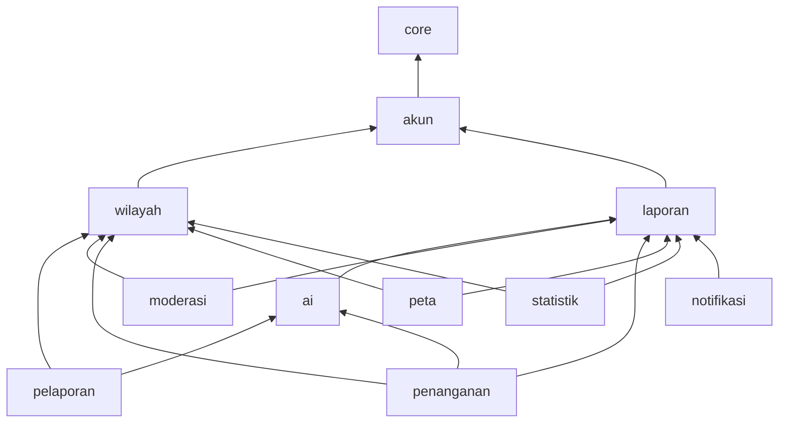

# JalanKu

> 🇬🇧 English: [README.md](README.md)

Aplikasi web (PWA) untuk warga **DKI Jakarta** melaporkan jalan rusak cukup dengan **foto**. Model AI memeriksa foto: bila yakin, laporan langsung diteruskan ke **Suku Dinas Bina Marga** kota tempat jalan itu; bila ragu, diperiksa Admin. Laporan aktif tampil sebagai **bubble di peta publik** dan baru pindah ke peta riwayat setelah petugas mengunggah **foto setelah perbaikan**.

Proyek kelompok COMP6100001 Software Engineering (BINUS University), SDG 11.2 dan 11.3. Lisensi MIT.

- **Menjalankan aplikasi:** [`app/README.md`](app/README.md)
- **Cara berkontribusi (Git, PR, review, aturan):** [`CONTRIBUTING.md`](CONTRIBUTING.md)
- **Dokumentasi API interaktif:** `http://localhost:8000/api/docs` saat server jalan; kontrak terkunci di [`app/kontrak/`](app/kontrak/)

## Isi repo

```
jalanku/
├── README.md            versi bahasa Inggris
├── README.id.md         ← kamu di sini (Bahasa Indonesia)
├── SECURITY.md · CODE_OF_CONDUCT.md · CHANGELOG.md
├── CONTRIBUTING.md      alur Git: issue → branch → PR → review → merge
├── LICENSE              MIT
├── .github/             CI (workflows/ci.yml), CODEOWNERS, template PR & issue
└── app/
    ├── README.md        install, jalan, test
    ├── pyproject.toml   dependency + konfigurasi pytest & ruff
    ├── requirements.lock  versi dependency PERSIS untuk semua anggota & CI
    ├── kontrak/         SNAPSHOT kontrak yang dikunci (openapi.json, modul.json)
    ├── jalanku/
    │   ├── main.py      perakit: memasang semua modul + web
    │   ├── core/        fondasi bersama
    │   ├── modules/     10 modul fitur — satu folder = satu pemilik, masing-masing punya README.md
    │   └── web/         frontend PWA; web/modules/<modul>/ mengikuti modul backend
    └── tests/           test lintas modul: arsitektur, integrasi, penerimaan, sistem
```

## Arsitektur

**Modular monolith**: satu aplikasi FastAPI, dibagi menjadi modul dengan batas tegas supaya enam orang bisa bekerja paralel tanpa saling merusak.

| Modul | Tanggung jawab | Slot |
|---|---|---|
| `core` | Konfigurasi, DB & migrasi, kejadian (event), galat, keamanan (header, CSRF, rate limit), penyimpanan berkas | M1 |
| `laporan` | Domain inti: laporan, nomor `JK-00001`, siklus status, timeline, foto aman, dukungan, visibilitas, detail publik | M1 |
| `notifikasi` | Kabar in-app saat status laporan berubah | M1 |
| `akun` | Pengguna, peran, sesi, daftar/verifikasi/masuk, hapus akun | M2 |
| `wilayah` | Kecamatan, kota, dan Sudin dari koordinat; data instansi | M2 |
| `pelaporan` | Alur warga: kirim laporan, lokasi, cek duplikat, dukung, laporan saya | M3 |
| `ai` | Pemeriksaan foto, keputusan otomatis, metrik model | M4 |
| `moderasi` | Antrean Admin, verifikasi/tolak/gabung, banding, paket penerusan | M5 |
| `statistik` | Statistik per Sudin, metrik hipotesis | M5 |
| `peta` | Data bubble peta aktif & riwayat | M6 |
| `penanganan` | Dashboard petugas: status, foto selesai + verifikasi AI, prioritas | M6 |

**Graf dependensi** (panah = boleh mengimpor antarmuka publik; semua modul boleh memakai `core` dan `akun`):



Arah sebaliknya memakai **kejadian**: `laporan` menerbitkan `LaporanDibuat` dan `StatusBerubah`; `notifikasi` & `statistik` mendengarkan. `akun` menerbitkan `AkunDihapus`; `laporan` mendengarkan.

## Aturan emas

1. **Satu modul, satu pemilik.** Mengubah folder modul orang lain hanya lewat PR yang di-review pemiliknya (CODEOWNERS).
2. **Modul hanya bicara lewat antarmuka publik**: `from jalanku.modules.<modul> import ...` (nama di `__all__`). Mengimpor isi dalam modul lain atau modul di luar graf → test arsitektur gagal.
3. **Kontrak dikunci.** Endpoint/skema (`app/kontrak/openapi.json`) dan antarmuka modul (`app/kontrak/modul.json`) dicek CI. Menambah sesuatu yang opsional = PR biasa + `python -m jalanku kontrak --tulis`. Mengubah/menghapus yang sudah ada = **change request** (issue template).
4. **Data milik modul.** Tabel berprefiks nama modul; modul lain membaca lewat fungsi publik. File migrasi yang sudah di-merge tidak diedit.
5. **Setiap modul selalu bisa jalan.** Fitur yang belum selesai berupa *stub* yang memenuhi kontrak (endpoint menjawab 501 + nama story & pemiliknya), jadi tidak ada yang harus menunggu.
6. **Tidak ada push langsung ke `main`.** PR kecil, CI hijau, ≥ 1 review.
7. **Jujur soal data.** Data contoh berlabel SIMULASI; tidak ada hasil uji atau wawancara karangan.

## Istilah

Nilai di kiri dipakai persis sama di API, database, dan kode.

| Kode | Arti |
|---|---|
| `menunggu_verifikasi` · `belum_dikerjakan` · `sedang_dikerjakan` · `selesai` · `ditolak` · `digabung` | Status laporan. Menunggu & ditolak hanya terlihat pelapor + Admin |
| `kurang_baik` · `rusak` | Tingkat kerusakan (kelas AI `baik` = tidak perlu dilaporkan) |
| `terverifikasi` · `ditolak` · `perlu_admin` · `tidak_aktif` | Keputusan AI per laporan (`tidak_aktif` = model mati → semua ke Admin) |
| `terima` · `tolak` · `admin` | Keputusan AI per foto |
| `ai` · `admin` · `petugas` · `pelapor` · `sistem` | Pelaku perubahan status (`ai` tampil sebagai "AI JalanKu") |
| `pelapor` · `petugas` · `admin` | Peran akun; petugas terikat satu instansi |
| `DINAS_BM`, `SUDIN_JP/JU/JB/JS/JT` | Dinas Bina Marga DKI (semua wilayah) dan Sudin per kota administrasi |
| `simulasi` | Data contoh/uji — wajib berlabel di UI, tidak dipakai sebagai bukti |
