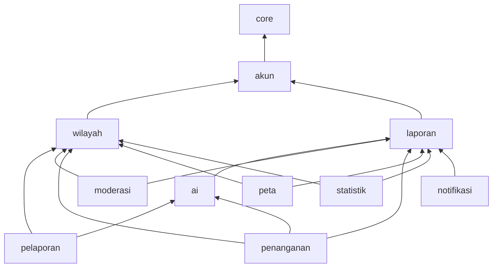

<div align="center">

# JalanKu

**Photo-first road damage reporting for Jakarta — AI-verified, routed to the right agency, tracked in public until repaired with proof.**

[](https://github.com/nichodarren/jalanku/actions/workflows/ci.yml)


🇮🇩 Bahasa Indonesia: [README.id.md](README.id.md)

</div>

---

## Why

Jakarta residents can already report potholes through government channels, but **the state of the roads and the follow-up are not publicly visible**, and trust in "repaired" evidence dropped after AI-fabricated follow-up photos were found on the city's complaint app in April 2026. Agencies, meanwhile, receive thousands of reports a month that must be checked by hand.

## What it does

1. **Report with a photo.** A resident takes 1–3 photos; the location comes from the photo's GPS, the phone's GPS, or a pin.
2. **AI triage with a human in the loop.** An on-device-friendly image model (EfficientNet-B0 features + logistic regression, ONNX, CPU) rates the road as *good / fair / damaged*. Confident results are decided automatically; uncertain or unrecognised photos go to a human moderator; automatic rejections can be appealed once.
3. **Automatic routing.** The report is assigned to the responsible *Suku Dinas Bina Marga* (city road agency) from the district polygon it falls in; locations outside Jakarta are redirected to the national channel.
4. **Public transparency.** Active reports appear as clustered bubbles on a public map; every status change is on a public timeline without the reporter's identity.
5. **Proof of repair.** Closing a report requires an after-repair photo, which is checked by the same AI model and shown publicly next to the original; the timeline is hash-chained so history cannot be silently edited.

## Quick start

Requires Python 3.12+ (the team uses 3.13).

```bash
cd app
python -m venv .venv && source .venv/bin/activate     # Windows: .venv\Scripts\activate
pip install -r requirements.lock && pip install -e . --no-deps
python -m jalanku.modules.wilayah.data.setup_wilayah  # once: district boundaries (GADM, not redistributed)
python -m pytest                                       # all tests must pass
python -m jalanku contoh-data                          # seed SIMULATED sample reports
python -m jalanku jalan --reload                       # http://localhost:8000 · API docs at /api/docs
```

More: [`app/README.md`](app/README.md).

## Architecture

A **modular monolith**: one FastAPI process serving the API, the ONNX model, and a build-free PWA (vanilla ES modules + Leaflet). Ten feature modules, each with a single owner, a public interface (`__all__`), its own tables and migrations, and tests.



| Module | Responsibility |
|---|---|
| `core` | Config, SQLite & per-module migrations, in-process events, errors, security headers / CSRF / rate limiting, file storage |
| `akun` | Accounts, roles, sessions, e-mail verification |
| `wilayah` | District → agency resolution (42 districts), agency channels |
| `laporan` | Report domain: numbering, status machine, timeline, safe photo storage, supports, visibility |
| `ai` | Photo assessment and automatic decision rules |
| `pelaporan` | Citizen reporting flow, duplicate detection (25 m), supports |
| `moderasi` | Moderator queue, appeals, forwarding package for official channels |
| `penanganan` | Agency officer dashboard, repair proof with AI check, priority |
| `peta` | Public active / history map data |
| `statistik` | Per-agency response statistics |
| `notifikasi` | In-app notifications |

Guard rails enforced in CI: modules may only import each other's public interface along the graph above (`tests/arsitektur/test_batas_modul.py`); the HTTP API and module interfaces are snapshot-locked in [`app/kontrak/`](app/kontrak/) (`tests/arsitektur/test_kontrak.py`). Domain identifiers are in Indonesian; see the glossary in [README.id.md](README.id.md#istilah).

## Project status

Academic project (COMP6100001 Software Engineering, BINUS University), developed in one-week Scrum sprints until December 2026. Feature modules start as contract-complete stubs and are filled in by their owners; see the [changelog](CHANGELOG.md).

## Contributing · Security · Conduct

- How we work (branching, commits, reviews, porting from the prototype): [CONTRIBUTING.md](CONTRIBUTING.md)
- Reporting vulnerabilities: [SECURITY.md](SECURITY.md)
- Community standards: [CODE_OF_CONDUCT.md](CODE_OF_CONDUCT.md)

## License & data

Code: [MIT](LICENSE). Map data © OpenStreetMap contributors (ODbL). District boundaries © GADM (non-commercial use, attribution required). Bundled Leaflet (BSD-2-Clause) and Leaflet.markercluster (MIT) keep their own licenses.
